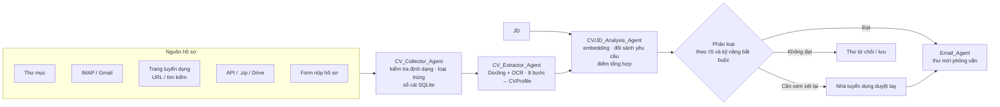

# cvagents – Hệ thống đánh giá hồ sơ ứng viên tự động dựa trên kiến trúc đa tác tử

Mã nguồn sản phẩm của khoá luận tốt nghiệp **"Nghiên cứu và phát triển hệ thống đánh giá hồ sơ ứng viên tự động dựa trên kiến trúc đa tác tử"**.

- Sinh viên: Phạm Đình Mạnh – MSV 11236150
- Giảng viên hướng dẫn: TS. Lưu Minh Tuấn
- Trường Đại học Kinh tế Quốc dân

## Mục lục

1. [Giới thiệu](#1-giới-thiệu)
2. [Kiến trúc và luồng xử lý](#2-kiến-trúc-và-luồng-xử-lý)
3. [Cấu trúc thư mục](#3-cấu-trúc-thư-mục)
4. [Yêu cầu hệ thống](#4-yêu-cầu-hệ-thống)
5. [Cài đặt](#5-cài-đặt)
6. [Mô hình nhúng](#6-mô-hình-nhúng)
7. [Cấu hình email](#7-cấu-hình-email)
8. [Chạy hệ thống](#8-chạy-hệ-thống)
9. [Kịch bản demo từng bước](#9-kịch-bản-demo-từng-bước)
10. [Dòng lệnh](#10-dòng-lệnh)
11. [Chi tiết từng tác tử](#11-chi-tiết-từng-tác-tử)
12. [Cấu hình ngưỡng và trọng số](#12-cấu-hình-ngưỡng-và-trọng-số)
13. [Kiểm thử và tái lập kết quả](#13-kiểm-thử-và-tái-lập-kết-quả)
14. [Xử lý sự cố](#14-xử-lý-sự-cố)
15. [Giới hạn và lưu ý](#15-giới-hạn-và-lưu-ý)

## 1. Giới thiệu

Hệ thống nhận hồ sơ (CV) của ứng viên từ nhiều nguồn và đọc CV ở nhiều định dạng: PDF có lớp văn bản, PDF quét, DOCX,
ảnh PNG/JPG. Sau đó hệ thống trích xuất thông tin, đối chiếu ngữ nghĩa CV với mô tả công việc (JD), chấm điểm, xếp
hạng và gửi thư mời phỏng vấn hoặc thư từ chối. Bốn tác tử phối hợp theo một luồng:

| Tác tử | Chức năng |
|---|---|
| **CV_Collector_Agent** | Thu thập CV từ thư mục, hộp thư IMAP/Gmail, trang tuyển dụng (crawler tuân thủ robots.txt), danh sách URL, máy tìm kiếm, API, bộ dữ liệu .zip/CSV, Google Drive và form nộp hồ sơ. Kiểm tra định dạng theo magic bytes, loại trùng 3 mức (trùng byte SHA-1, gần trùng SimHash/dHash, cùng ứng viên) và lưu sổ cái SQLite |
| **CV_Extractor_Agent** | Pipeline 8 bước: kiểm tra chất lượng lớp văn bản, chuyển sang OCR khi cần (Docling + EasyOCR), sắp thứ tự đọc hai cột, chuẩn hoá, nhận diện mục, trích xuất thực thể (regex, gazetteer + so khớp mờ rapidfuzz), gom trường, tính độ tin cậy và cảnh báo |
| **CV/JD_Analysis_Agent** | Phân tích JD thành yêu cầu bắt buộc / ưu tiên / kinh nghiệm / học vấn, mã hoá bằng Vietnamese_Embedding đã tinh chỉnh, đối sánh từng yêu cầu với bằng chứng trong CV, tính điểm tổng hợp và phân loại **Đạt / Cần xem xét lại / Không đạt** |
| **Email_Agent** | Soạn và gửi thư mời phỏng vấn / thư từ chối qua SMTP (hoặc lưu nháp .eml), có nhật ký chống gửi trùng |

Có hai giao diện web Streamlit:

- **Giao diện nhà tuyển dụng** (`scripts/recruiter_app.py`) gồm 4 trang: Thu thập hồ sơ, Đánh giá hồ sơ, Xếp hạng
  ứng viên, Cài đặt email.
- **Form nộp hồ sơ cho ứng viên** (`scripts/candidate_portal.py`): hồ sơ nộp qua form đi thẳng vào hộp thu thập.

Kèm theo là một **trang tuyển dụng giả lập** (`scripts/mock_jobsite.py`) để thử crawler và chạy demo mà không cần Internet.

## 2. Kiến trúc và luồng xử lý



Quy tắc phân loại (`src/cvagents/analysis/scoring.py`, hàm `screening_status`):

1. CV đáp ứng dưới `must_min` (75%) kỹ năng bắt buộc thì **Không đạt**, bất kể điểm.
2. Điểm tổng ≥ `pass_threshold` (τS = 0,589) thì **Đạt**. Nếu CV vẫn thiếu một phần kỹ năng bắt buộc, kết quả tối đa
   là Cần xem xét lại.
3. Điểm nằm trong [τS − `review_margin`, τS) thì **Cần xem xét lại**, chờ nhà tuyển dụng duyệt trên giao diện.
4. Các trường hợp còn lại là **Không đạt**.

Ứng viên Đạt được tự động gửi thư mời. τS cố định theo `config.toml`; giao diện không cho đổi ngưỡng.

## 3. Cấu trúc thư mục

```
├── README.md
├── pyproject.toml               khai báo gói cvagents và các nhóm thư viện phụ thuộc
├── .streamlit/config.toml       theme và tuỳ chọn của giao diện Streamlit
├── src/cvagents/
│   ├── common/                  schemas (CVProfile, JobDescription, AnalysisReport), nạp cấu hình, tiện ích chuỗi
│   ├── collector/               CV_Collector_Agent
│   │   ├── sources/             folder, imap, web (crawler), search, net (HTTP), api, dataset, drive
│   │   ├── changes.py           phát hiện thay đổi trang giữa các lần crawl, lưu phiên bản trang
│   │   ├── validate.py          kiểm tra định dạng tệp theo magic bytes
│   │   ├── fingerprint.py       loại trùng 3 mức
│   │   ├── store.py             sổ cái SQLite
│   │   ├── scheduler.py         thu thập định kỳ, dọn hồ sơ quá hạn, ghi log
│   │   ├── mocksite.py          trang tuyển dụng + API + máy tìm kiếm giả lập
│   │   └── agent.py             điều phối tác tử
│   ├── extractor/               CV_Extractor_Agent (pipeline 8 bước, xem mục 11.2)
│   ├── analysis/                CV/JD_Analysis_Agent (jd_parser, embedder, matching, scoring, agent)
│   ├── mailer/                  Email_Agent
│   ├── screening.py             điều phối một đợt sàng lọc: Collector → Extractor → Analysis → Email
│   └── resources/               config.toml, sections.json, skills.json, email_templates.json, english_words.json
├── scripts/
│   ├── recruiter_app.py         giao diện Streamlit cho nhà tuyển dụng
│   ├── candidate_portal.py      form nộp hồ sơ cho ứng viên
│   ├── mock_jobsite.py          trang tuyển dụng giả lập
│   ├── collect.py               CV_Collector dòng lệnh (một lần / theo dõi liên tục / theo giờ)
│   ├── run_pipeline.py          chạy Extractor + Analysis trên một CV và một JD
│   ├── send_emails.py           Email_Agent dòng lệnh
│   ├── demo_pdf.py              chạy minh hoạ toàn hệ thống trên vài CV PDF
│   ├── translate_dataset.py     dịch bộ dữ liệu CV–JD sang tiếng Việt (cần GPU)
│   ├── finetune_embedding.py    tinh chỉnh Vietnamese_Embedding (cần GPU)
│   ├── eval_matching.py         thử nghiệm nhóm A: đối sánh CV–JD (KB1–KB4, BM25, VM)
│   ├── compare_configs.py       kiểm định bootstrap ghép cặp giữa các cấu hình
│   ├── eval_pdf.py              đối sánh khi CV vào hệ thống dưới dạng PDF / PDF quét
│   ├── make_noisy.py            tạo bản quét có nhiễu từ CV PDF
│   ├── eval_extractor.py        thử nghiệm nhóm B: CV_Extractor
│   ├── eval_cv_mau.py           chạy toàn hệ thống trên bộ CV mẫu
│   ├── eval_collector.py        kịch bản K3: CV_Collector (Bảng 3.8)
│   └── eval_e2e.py              kiểm thử tích hợp toàn hệ thống
├── tests/                       kiểm thử đơn vị (pytest)
├── data/
│   ├── raw/                     JD mẫu: sample_jd.txt (Python/FastAPI), jd_backend_dotnet.txt
│   ├── cv_mau/                  10 CV mẫu × 6 định dạng (.txt, .pdf, _scan.pdf, .docx, .jpg, .png) + nhan.csv
│   └── cv_demo_moi/             bộ demo: 6 CV (CV11–CV16), 2 JD, trang giả lập, hướng dẫn HUONG_DAN.md
└── _dong_goi/                   script đóng gói bản nộp ZIP (cấu hình đường dẫn mô hình tương đối)
```

Các thư mục sau được tạo tự động khi chạy và không đưa lên Git: `data/inbox` (CV đã nhận + sổ cái `collector.db` +
phiên bản trang), `data/outbox` (thư nháp .eml), `data/logs`, `data/processed` (nhật ký thư đã gửi).

## 4. Yêu cầu hệ thống

- Python **3.11** trở lên (đã chạy trên Windows 11).
- RAM tối thiểu 8 GB. CPU đủ để chạy giao diện và đánh giá hồ sơ; GPU chỉ cần khi dịch dữ liệu và tinh chỉnh mô hình
  (khoá luận dùng Google Colab T4).
- Khoảng 6 GB dung lượng trống cho thư viện và hai mô hình nhúng.
- Kết nối Internet ở lần chạy đầu để tải mô hình OCR và mô hình nhúng gốc (nếu dùng) từ Hugging Face.

## 5. Cài đặt

```bat
git clone https://github.com/manhphamdinh/cvagents.git
cd cvagents
python -m venv .venv
.venv\Scripts\activate
pip install -e ".[docling,embedding,ui,eval,dev]" easyocr
```

Các nhóm thư viện tuỳ chọn trong `pyproject.toml`:

| Nhóm | Thư viện | Dùng cho |
|---|---|---|
| `docling` | docling, rapidocr, onnxruntime | đọc PDF/DOCX/ảnh, OCR |
| `embedding` | sentence-transformers | mô hình nhúng |
| `ui` | streamlit, pandas, openpyxl | giao diện web |
| `eval` | scikit-learn, scipy, pandas, pypdfium2 | các script thử nghiệm |
| `train` | sentence-transformers, datasets, accelerate | tinh chỉnh mô hình |
| `drive` | google-api-python-client, google-auth | nguồn Google Drive |
| `dev` | pytest | kiểm thử |

Nếu đường dẫn thư mục có chữ tiếng Việt có dấu và `pip install -e` báo lỗi, cài thư viện trực tiếp rồi dùng `PYTHONPATH`.
Các script trong `scripts/` tự thêm `src` vào `sys.path` nên vẫn chạy được mà không cần cài gói:

```bat
pip install pydantic rapidfuzz docling rapidocr onnxruntime sentence-transformers streamlit pandas openpyxl scikit-learn scipy pypdfium2 pytest easyocr
set PYTHONPATH=src
```

Kiểm tra cài đặt:

```bat
python -m pytest
```

## 6. Mô hình nhúng

Hai mô hình tinh chỉnh từ `AITeamVN/Vietnamese_Embedding` (BGE-M3), mỗi mô hình khoảng 2,3 GB, **không có trong repo**:

| Thư mục | Dùng cho | Dữ liệu tinh chỉnh |
|---|---|---|
| `models/vn-embedding-cvjd` | JD tiếng Anh | bộ Resume–Job Matching `rahulrajpu676/job-resume-matching` (Hugging Face) |
| `models/vn-embedding-cvjd-vi` | JD tiếng Việt | bộ trên, dịch sang tiếng Việt bằng `vinai-translate-en2vi-v2` |

Hệ thống chọn mô hình tự động theo ngôn ngữ của JD. Đường dẫn khai báo ở `src/cvagents/resources/config.toml`, mục
`[analysis]`, hai khoá `embed_model` và `embed_model_vi`.

> **Lưu ý:** trong repo, hai khoá này đang trỏ tới thư mục lưu mô hình trên máy tác giả (`D:/Neu/...`). Trên máy khác,
> hãy sửa hai khoá theo một trong ba cách dưới đây. Bản `_dong_goi/config.toml` dùng sẵn đường dẫn tương đối `models/...`.

1. **Dùng mô hình gốc** (nhanh nhất, để chạy thử): đặt cả hai khoá thành `"AITeamVN/Vietnamese_Embedding"`. Mô hình
   được tải từ Hugging Face ở lần chạy đầu. Hệ thống chạy đủ chức năng nhưng độ chính xác đối sánh thấp hơn kết quả
   trong khoá luận.
2. **Nhận bản mô hình từ tác giả:** đặt thư mục nhận được vào `models/`, rồi đặt hai khoá thành
   `"models/vn-embedding-cvjd"` và `"models/vn-embedding-cvjd-vi"`.
3. **Huấn luyện lại** (cần GPU):

   ```bat
   pip install -e ".[train]"
   python scripts/finetune_embedding.py --out models/vn-embedding-cvjd
   python scripts/translate_dataset.py --out data/cvjd_vi
   python scripts/finetune_embedding.py --data-dir data/cvjd_vi --out models/vn-embedding-cvjd-vi --grad-checkpointing
   ```

   Kết quả của mô hình gốc và mô hình sau tinh chỉnh trên tập kiểm tra được ghi vào `<thư mục --out>/results.json`.

## 7. Cấu hình email

Khi **chưa** có tài khoản SMTP, Email_Agent lưu mỗi thư thành tệp nháp `.eml` trong `data/outbox` để xem trước; hệ
thống vẫn chạy bình thường. Để gửi thật qua Gmail:

1. Bật **Xác minh 2 bước** cho tài khoản Google.
2. Tạo **App Password** tại <https://myaccount.google.com/apppasswords>. Google hiện 16 ký tự một lần duy nhất. Nếu quên,
   chỉ cần tạo mật khẩu mới và xoá mật khẩu cũ.
3. Đặt biến môi trường. Dùng `setx` để lưu vĩnh viễn cho người dùng Windows; mở terminal mới thì biến mới có hiệu lực:

   ```bat
   setx SMTP_USER "tuyendung@gmail.com"
   setx SMTP_PASSWORD "abcd efgh ijkl mnop"
   ```

   Chỉ cần cho phiên terminal hiện tại thì dùng `set SMTP_USER=...` và `set SMTP_PASSWORD=...`.

Cách khác: nhập tài khoản ở trang **Cài đặt email** của giao diện nhà tuyển dụng (chỉ giữ trong phiên làm việc). Trang
này cũng cho sửa tên công ty, người gửi và mẫu thư mời.

| Biến môi trường | Mặc định | Ý nghĩa |
|---|---|---|
| `SMTP_USER`, `SMTP_PASSWORD` | – | tài khoản gửi thư (Gmail: App Password) |
| `SMTP_HOST`, `SMTP_PORT` | `smtp.gmail.com`, `587` | máy chủ SMTP (STARTTLS) |
| `IMAP_USER`, `IMAP_PASSWORD`, `IMAP_HOST` | –, –, `imap.gmail.com` | hộp thư nguồn của Collector |
| `SEARCH_API_KEY`, `GOOGLE_CSE_ID` | – | API máy tìm kiếm (Brave / Google Programmable Search) |
| `GOOGLE_APPLICATION_CREDENTIALS` | – | tệp khoá service account cho nguồn Google Drive |

Mật khẩu không bao giờ được ghi vào `config.toml` hay vào repo.

## 8. Chạy hệ thống

Chạy mọi lệnh **từ thư mục gốc của dự án**, vì `data/inbox`, `data/outbox` và `.streamlit/config.toml` là đường dẫn tương đối.

| Thành phần | Lệnh | Địa chỉ |
|---|---|---|
| Giao diện nhà tuyển dụng | `python -m streamlit run scripts/recruiter_app.py` | <http://localhost:8501> |
| Form nộp hồ sơ | `python -m streamlit run scripts/candidate_portal.py --server.port 8502` | <http://localhost:8502> |
| Trang tuyển dụng giả lập | `python scripts/mock_jobsite.py data/cv_demo_moi/trang_gia_lap_chay --port 8765` | <http://127.0.0.1:8765> |

Có thể truyền danh sách vị trí cho form nộp hồ sơ qua URL, ví dụ
<http://localhost:8502/?vi_tri=Tester,Backend%20Developer>. Ứng viên sẽ chọn vị trí từ danh sách thay vì tự gõ.

### Giao diện nhà tuyển dụng

- **Thu thập hồ sơ**: cấu hình nguồn (thư mục, IMAP, trang tuyển dụng, danh sách URL, máy tìm kiếm, API, bộ dữ liệu,
  Google Drive), bấm "Thu thập ngay" hoặc bật tự động theo chu kỳ / giờ cố định, chỉnh ngưỡng crawler, xem sổ cái hồ sơ,
  phiên bản và khác biệt của từng trang đã crawl.
- **Đánh giá hồ sơ**: dán hoặc tải JD, tải lên nhiều CV (PDF, DOCX, PNG, JPG) hoặc lấy hồ sơ đang chờ trong hộp thu thập.
- **Xếp hạng ứng viên**: điểm, trạng thái và bằng chứng cho từng yêu cầu; lọc theo trạng thái. Bấm một dòng để mở chi
  tiết: đánh giá từng thành phần, ảnh gốc kèm khối nhận diện, hồ sơ trích xuất, và duyệt tay hồ sơ "Cần xem xét lại".
  Nút "Gửi thư mời" gửi cho các CV Đạt chưa nhận thư.
- **Cài đặt email**: tài khoản SMTP, kiểm tra kết nối, tên công ty, người gửi, mẫu thư.

## 9. Kịch bản demo từng bước

Bộ demo nằm trong `data/cv_demo_moi`; chi tiết ở [`data/cv_demo_moi/HUONG_DAN.md`](data/cv_demo_moi/HUONG_DAN.md).
Gồm 6 CV hư cấu và 2 JD:

| Đợt | CV | Hồ sơ | Nộp vào tin | Định dạng | Kỹ năng bắt buộc | Kết quả mong đợi |
|---|---|---|---|---|---|---|
| 1 (crawl) | CV11 Lê Hoàng Phúc | Backend .NET, 3,5 năm | .NET | PDF có lớp chữ | 6/6 | **Đạt** |
| 1 (crawl) | CV12 Nguyễn Thu Hà | Python/FastAPI, 3 năm | Python | DOCX | 3/3 | **Đạt** |
| 1 (crawl) | CV13 Hoang Gia Bao | Java Spring Boot, CV tiếng Anh | .NET | JPG (OCR) | 4/6 | Không đạt |
| 2 (form) | CV15 Phan Ngọc Mai | .NET, 2 năm | .NET | PDF có lớp chữ | 6/6 | **Đạt** |
| 2 (form) | CV14 Trịnh Quốc Việt | Python Django, 2,5 năm | Python | PNG (OCR) | 2/3 | Không đạt |
| 2 (form) | CV16 Đinh Thảo Vy | Phân tích dữ liệu | Python | PDF quét (OCR) | 1/3 | Không đạt |

CV13 và CV14 là hai ca "gần đạt": cùng ngành, điểm toàn văn có thể cao, nhưng bị luật kỹ năng bắt buộc loại.

Các bước:

1. **Dọn dữ liệu cũ** để các CV của lần chạy trước không lẫn vào kết quả: xoá `data/inbox`, `data/outbox`, `data/logs`.
2. **Tạo bản chạy của trang giả lập.** Form nộp hồ sơ trên trang ghi tệp vào thư mục này, nên giữ bản gốc để chạy lại:

   ```bat
   xcopy /E /I "data\cv_demo_moi\trang_gia_lap" "data\cv_demo_moi\trang_gia_lap_chay"
   set PYTHONUTF8=1
   python scripts/mock_jobsite.py data/cv_demo_moi/trang_gia_lap_chay --port 8765
   ```

3. **Mở giao diện nhà tuyển dụng** (mục 8). Ở trang Thu thập hồ sơ, nhập `http://127.0.0.1:8765/` làm trang tuyển dụng,
   bấm "Thu thập ngay": nhận **3 hồ sơ** của đợt 1.
4. **Nộp CV đợt 2:** mở <http://127.0.0.1:8765/>, vào từng tin và nộp 3 CV trong `data/cv_demo_moi/tai_len_dot_2` theo
   `thong_tin_nop_form.csv`.
5. **Thu thập lại:** trang tin đã thay đổi, nên chỉ 3 hồ sơ vừa nộp được nhận thêm.
6. **Đánh giá** từng tin với JD tương ứng trong `data/cv_demo_moi/jd/`, rồi xem trang Xếp hạng ứng viên. Ứng viên Đạt
   nhận thư mời (gửi thật nếu đã cấu hình SMTP, nếu không thì lưu .eml).

Ba CV đạt dùng cùng một email, nên Collector gắn cờ "cùng ứng viên". Đây chỉ là cờ, không loại hồ sơ; thư mời vẫn gửi
đủ vì nhật ký chống gửi trùng ghi khoá theo băm của CV.

## 10. Dòng lệnh

```bat
:: Chạy một CV với một JD
python scripts/run_pipeline.py <CV .pdf/.docx/.png> data/raw/jd_backend_dotnet.txt

:: Thu thập: thư mục + IMAP, theo dõi mỗi 5 phút
python scripts/collect.py --folder "D:/Tuyen dung/CV" --imap --watch --interval 300
:: Thu thập rồi đánh giá và gửi thư ngay
python scripts/collect.py --imap --jd data/raw/sample_jd.txt --vi-tri "Backend Developer"
:: Liệt kê hồ sơ mới trong sổ cái
python scripts/collect.py --list moi
:: Crawl trang tuyển dụng + máy tìm kiếm (giả lập)
python scripts/collect.py --web http://127.0.0.1:8765/ --search backend --search-api searxng --search-url http://127.0.0.1:8765/tim-kiem
:: Giới hạn crawler
python scripts/collect.py --web http://127.0.0.1:8765/ --depth 2 --max-pages 30 --delay 2 --nguong-thay-doi 0.05
:: Thu thập theo giờ cố định mỗi ngày
python scripts/collect.py --url-file ds_url.txt --at 08:00,20:00

:: Email_Agent: lưu nháp, hoặc gửi thật với --send
python scripts/send_emails.py data/processed --vi-tri "Backend Developer"
python scripts/send_emails.py data/processed --vi-tri "Backend Developer" --send
```

Để thu thập khi không mở giao diện, đăng ký với Task Scheduler của Windows (phải `cd` vào thư mục dự án):

```bat
schtasks /Create /SC DAILY /ST 08:00 /TN "CV crawler" /TR "cmd /c cd /d \"<thư mục dự án>\" && \"<python.exe của .venv>\" scripts\collect.py --url-file ds_url.txt"
```

## 11. Chi tiết từng tác tử

Cài đặt theo Chương 2 của khoá luận (mục 2.3 trích xuất, 2.4–2.5 đối chiếu ngữ nghĩa). Số công thức trong bảng là số
trong khoá luận.

### 11.1. CV_Collector_Agent

Hồ sơ đi qua: nguồn → giải nén .zip → kiểm tra định dạng → loại trùng byte → loại gần trùng → nhận diện cùng ứng viên
(chỉ đánh dấu) → lưu vào `data/inbox/files/` với trạng thái "Chờ đánh giá". Mọi tệp, kể cả bị loại, đều có một dòng
trong sổ cái kèm lý do, nên tính được các độ đo K3. Mỗi nguồn thu thập tăng dần (thư mục: kích thước + thời điểm sửa;
IMAP: UID; web/API: URL / id). Một nguồn lỗi không làm dừng các nguồn khác.

| Tệp | Nội dung |
|---|---|
| `sources/` | folder (thư mục, theo dõi), imap (Gmail/IMAP), web (crawler, robots.txt; danh sách URL theo dõi), search (API máy tìm kiếm), net (HTTP: robots.txt, giãn cách, thử lại), api (JSON phân trang), dataset (thư mục/.zip + CSV), drive (Google Drive) |
| `validate.py` | định dạng theo magic bytes; PDF hỏng / có mật khẩu / quá nhiều trang, .doc cũ, zip bomb, ảnh quá nhỏ |
| `fingerprint.py` | trùng byte (SHA-1), gần trùng (SimHash văn bản ≤ 3/64 bit, dHash ảnh ≤ 4/64 bit), cùng ứng viên (email / SĐT) |
| `store.py` | sổ cái SQLite `data/inbox/collector.db`: bảng `cv`, `state`, `runs`, `trang`, `phien_ban` |
| `changes.py` | phát hiện thay đổi trang, lưu phiên bản trang |
| `scheduler.py` | thu thập theo chu kỳ hoặc giờ cố định, dọn hồ sơ quá hạn, ghi `data/logs/collector.log` |

**Crawler.** Ba nguồn web dùng chung một crawler (`sources/web.py`). Crawler tuân thủ robots.txt, không đăng nhập và
không vượt CAPTCHA:

| Nguồn | Tham số | Cách đi |
|---|---|---|
| Trang tuyển dụng | `--web URL` | theo liên kết trong cùng tên miền, tối đa `crawl_max_depth` bước |
| Danh sách URL theo dõi | `--url URL`, `--url-file ds.txt` | chỉ các URL đã cho (tệp CV hoặc trang chứa CV) |
| Máy tìm kiếm | `--search "truy vấn"` | URL kết quả của API tìm kiếm (SearXNG / Brave / Google Programmable Search), rồi đi như danh sách URL |

| Ngưỡng crawler | Khoá `[collector]` | Mặc định | Hành động khi chạm ngưỡng |
|---|---|---|---|
| Giãn cách giữa hai yêu cầu | `crawl_delay` | 1 s | chờ (lấy max với Crawl-delay của robots.txt) |
| Số trang / số tệp mỗi nguồn mỗi lần | `crawl_max_pages`, `crawl_max_tep` | 50 / 500 | dừng lần chạy của nguồn |
| Độ sâu liên kết | `crawl_max_depth` | 3 | không đi tiếp |
| Thử lại lỗi tạm thời (429, 5xx, hết giờ) | `crawl_retries`, `crawl_backoff` | 2 lần, 2 s ×2 | chờ rồi thử lại, theo Retry-After nếu có |
| Lỗi tải liên tiếp | `crawl_max_loi_lien_tiep` | 5 | dừng nguồn, báo lỗi nguồn |
| Thay đổi trang | `nguong_thay_doi` | 0,02 | lưu phiên bản trang mới, kiểm tra lại các CV trên trang |

**Phát hiện thay đổi** (`changes.py`). Phần chữ hiển thị của mỗi trang HTML được so với phiên bản đã lưu gần nhất:
δ = 1 − 2M / (|A| + |B|) trên các dòng chữ (M: số dòng khớp, difflib). Trang mới, hoặc trang có δ ≥ `nguong_thay_doi`,
được lưu thành phiên bản kế tiếp trong `data/inbox/pages/`. Thay đổi nhỏ hơn được cộng dồn tới khi vượt ngưỡng. Tệp CV
chỉ được tải lại khi trang chứa nó thay đổi (hoặc tệp nằm trong danh sách URL), và chỉ chuyển cho Extractor khi SHA-1
khác lần trước. Xem lại phiên bản và khác biệt ở trang Thu thập hồ sơ, hoặc bằng `collect.py --trang`.

### 11.2. CV_Extractor_Agent

| Tệp | Bước | Nội dung | Công thức |
|---|---|---|---|
| `reader.py` | 1–2 | Docling + OCR (adapter) | |
| `quality.py` | 1 | mật độ chữ, tỷ lệ ký tự lạ, tỷ lệ từ có trong từ điển → quyết định chuyển OCR | (2.2)–(2.5) |
| `layout.py` | 2 | lọc khối OCR theo độ tin cậy, thứ tự đọc hai cột | (2.6)–(2.7) |
| `normalize.py` | 3 | NFC, bullet, gạch ngang | |
| `sections.py` | 4–5 | tiêu đề mục (Bảng 2.1), bảng | |
| `entities.py` | 6 | regex, gazetteer + rapidfuzz, ngày, GPA | (2.8), (2.9), (2.11) |
| `fields.py` | 7 | gom trường, tổng tháng kinh nghiệm | (2.10) |
| `confidence.py` | 8 | độ tin cậy κ, độ đầy đủ φ, cảnh báo | (2.12), (2.13) |
| `visualize.py` | | vẽ khối bố cục (nhãn, thứ tự đọc) và ô OCR lên ảnh trang | |

### 11.3. CV/JD_Analysis_Agent

| Tệp | Nội dung |
|---|---|
| `jd_parser.py` | JD → yêu cầu bắt buộc / ưu tiên / kinh nghiệm / học vấn |
| `embedder.py` | Vietnamese_Embedding (BGE-M3) + bộ nhớ đệm; chọn mô hình theo ngôn ngữ JD; `HashingEmbedder` cho kiểm thử |
| `matching.py` | cosine giữa từng yêu cầu và bằng chứng trong CV; kỹ năng khớp chính xác hoặc theo bí danh |
| `scoring.py` | sáu điểm thành phần (toàn văn, bắt buộc, ưu tiên, ngữ nghĩa, kinh nghiệm, học vấn), điểm tổng và phân loại |

Sáu trọng số được học trên tập kiểm định có cặp âm cùng ngành. Cả bản tiếng Việt và tiếng Anh đều cho trọng số toàn văn
bằng 1,0, vì nhãn của bộ dữ liệu không dựa vào kỹ năng. Kỹ năng bắt buộc vẫn được tính, hiển thị và tác động qua luật
`must_min`.

### 11.4. Email_Agent

`mailer/agent.py`: thư mời phỏng vấn / thư từ chối theo mẫu `resources/email_templates.json`. Có SMTP thì gửi thật,
không có thì lưu .eml. Nhật ký `data/processed/email_log.json` ngăn gửi trùng khi đánh giá lại cùng một CV.

## 12. Cấu hình ngưỡng và trọng số

Mọi ngưỡng và trọng số nằm trong `src/cvagents/resources/config.toml`:

| Mục | Khoá chính | Giá trị |
|---|---|---|
| `[extractor]` | `ocr_engine`, `tau_rho`, `tau_la`, `tau_td`, `tau_ocr`, `tau_skill` | easyocr, 200, 0,05, 0,60, 0,5, 90 |
| `[analysis]` | `pass_threshold` (τS) | **0,589**: F1 lớn nhất của KB4 trên tập kiểm định tiếng Việt có cặp âm cùng ngành (bản tiếng Anh: 0,596) |
| | `review_margin` | 0,05 |
| | `match_threshold` (τkh) | 0,60: cosine tối thiểu để coi một yêu cầu dạng câu được đáp ứng |
| | `must_min` | 0,75: tỷ lệ kỹ năng bắt buộc tối thiểu |
| | `w_fulltext` … `w_education` | 1,0 / 0 / 0 / 0 / 0 / 0 |
| `[email]` | `smtp_host`, `smtp_port`, `cong_ty`, `nguoi_gui`, `outbox`, `sent_log` | |
| `[collector]` | kích thước, số trang, Hamming SimHash/dHash, chu kỳ, số ngày lưu (`luu_toi_da_ngay` = 180), crawler | |

## 13. Kiểm thử và tái lập kết quả

```bat
python -m pytest
```

Tái lập các thử nghiệm ở Chương 3. Bộ dữ liệu `rahulrajpu676/job-resume-matching` được tải tự động từ Hugging Face;
bản tiếng Việt do `translate_dataset.py` tạo:

```bat
python scripts/eval_matching.py --lang en --out results/A_en
python scripts/eval_matching.py --lang vi --data-dir data/cvjd_vi --out results/A_vi
python scripts/compare_configs.py --dir results/A_vi --pairs KB2:KB1,KB3:KB2,KB4:KB3,KB4:KB1,KB4:BM25,KB4:VM
python scripts/eval_pdf.py --lang vi --data-dir data/cvjd_vi --out results/pdf_vi --n-cv 200 --ket-qua-chinh results/A_vi/ket_qua.json
python scripts/eval_collector.py --synthetic 90                   :: K3, CV tổng hợp
python scripts/eval_collector.py --cv-dir data/k3_cv --extract    :: K3, CV thật (cần docling)
```

Kịch bản K3 (Bảng 3.8) chia CV gốc cho ba nguồn (trang tuyển dụng giả lập, API, bộ dữ liệu .zip). Bộ dữ liệu được cài
thêm bản sao, bản lưu lại, tệp hỏng và liên kết 404 có nhãn; sau khi chạy Collector, kết quả được so với nhãn.

## 14. Xử lý sự cố

| Hiện tượng | Nguyên nhân | Cách xử lý |
|---|---|---|
| `streamlit.exe` thoát ngay, không in gì | `.venv` bị chuyển thư mục sau khi tạo nên launcher `.exe` trỏ sai đường dẫn | chạy `python -m streamlit run ...`, hoặc tạo lại `.venv` |
| `UnicodeEncodeError: 'charmap' codec` khi chạy script | console Windows dùng mã cp1252, không in được tiếng Việt | `set PYTHONUTF8=1` trước khi chạy |
| `pip install -e` lỗi | đường dẫn có chữ có dấu | cài thư viện trực tiếp, `set PYTHONPATH=src` (mục 5) |
| Docling không mở được tệp tài nguyên | thư mục cài đặt có chữ có dấu | `reader.py` tự chuyển sang backend pypdfium2 cho PDF |
| Không tìm thấy mô hình nhúng | `embed_model` trỏ tới đường dẫn trên máy tác giả | sửa theo mục 6 |
| Thư không được gửi, chỉ có .eml | chưa đặt `SMTP_USER` / `SMTP_PASSWORD`, hoặc chưa mở terminal mới sau `setx` | mục 7 |
| Gmail báo `Username and Password not accepted` | dùng mật khẩu thường thay vì App Password | tạo App Password (mục 7) |
| Kết quả lẫn CV của lần chạy trước | `data/inbox` còn hồ sơ cũ | xoá `data/inbox`, `data/outbox`, `data/logs` |

## 15. Giới hạn và lưu ý

- OCR mặc định là EasyOCR (tiếng Việt và tiếng Anh). RapidOCR (PP-OCRv5 Latin) làm rơi dấu ("Nguyễn Văn" → "Nguyn Vn")
  nên không dùng mặc định; đổi ở `ocr_engine`.
- Không dùng mô hình NER: họ tên và tên tổ chức được nhận diện bằng quy tắc (`entities.find_name`, `is_org`).
- DOCX không có ảnh trang (Docling đọc cấu trúc tài liệu, không qua bố cục trang), nên trang chi tiết chỉ liệt kê khối.
- Gần trùng dùng ngưỡng Hamming 3/64 bit (SimHash) và 4/64 bit (dHash): CV sửa vài dòng vẫn được nhận như hồ sơ mới.
  Hồ sơ cùng email / SĐT với hồ sơ cũ chỉ được đánh dấu "Cùng ứng viên" để nhà tuyển dụng tự quyết.
- Crawler đọc HTML tĩnh, không chạy JavaScript. Vì vậy nó không lấy được CV từ trang tải nội dung bằng JavaScript hoặc
  yêu cầu đăng nhập, gồm phần lớn kho CV của TopCV, VietnamWorks, LinkedIn. Trang CV dạng HTML được lưu phiên bản nhưng
  không chuyển cho Extractor (Extractor chỉ đọc PDF, DOCX, PNG, JPG).
- Crawler chỉ đi trong cùng tên miền với trang bắt đầu và tuân thủ robots.txt. Không dùng crawler để thu thập từ trang
  của bên thứ ba khi điều khoản của trang đó không cho phép.
- **Dữ liệu cá nhân:** CV công khai trên Internet vẫn là dữ liệu cá nhân theo Nghị định 13/2023/NĐ-CP. Chỉ thu thập khi
  điều khoản của trang cho phép, chỉ dùng cho mục đích nghiên cứu, và để `luu_toi_da_ngay` xoá đúng hạn (phiên bản
  trang cũ cũng bị xoá, chỉ giữ phiên bản mới nhất làm mốc so). Các CV trong `data/cv_mau` và `data/cv_demo_moi` là
  nhân vật hư cấu.
